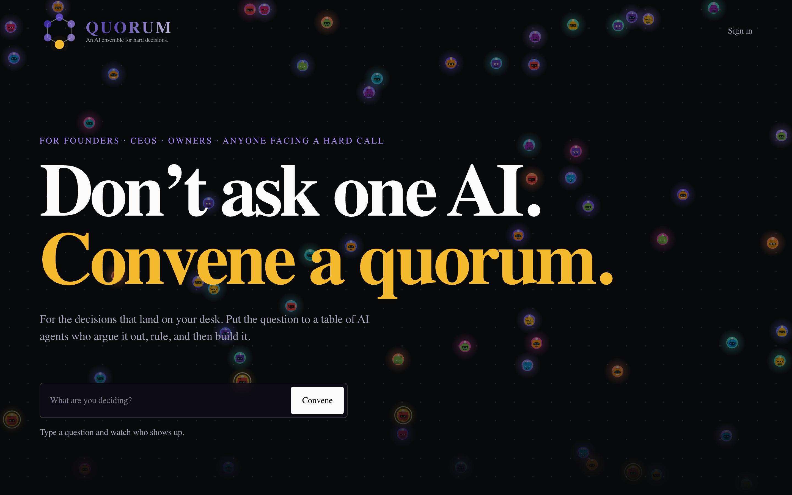
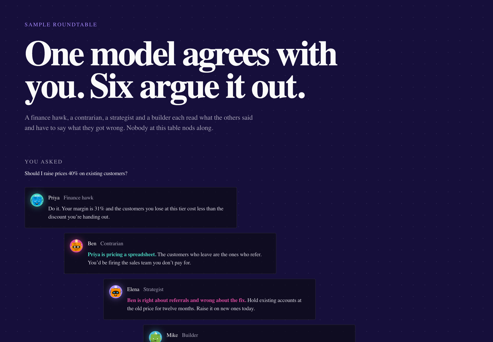
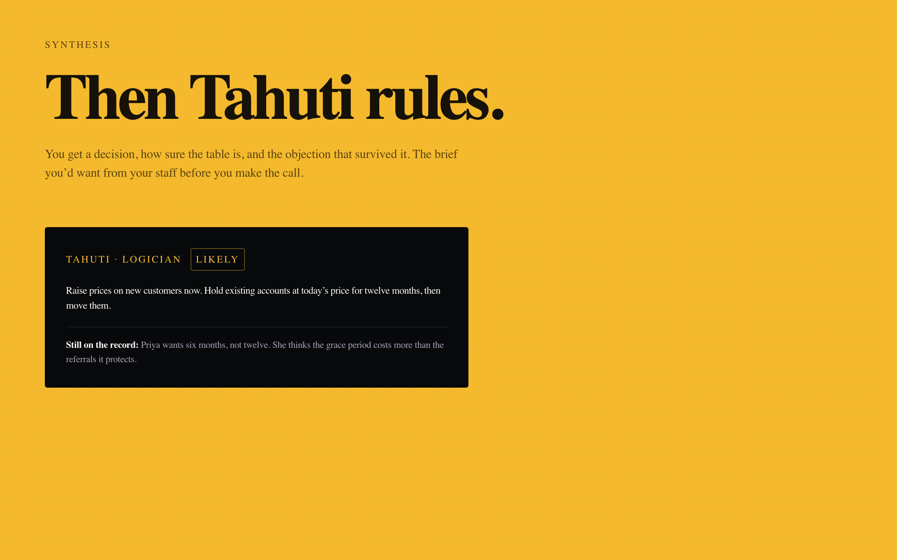
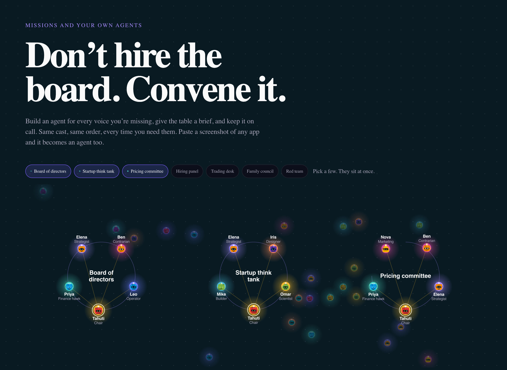

# Quorum

Chat-native multi-agent platform where users convene AI agents with distinct personalities, domains, and voices — for solo sessions or live roundtables where agents react to each other.

▶ Launch video: [landscape 16:9 · 44s](media/quorum-launch-16x9.mp4) · [vertical 9:16 for mobile · 44s](media/quorum-launch-9x16.mp4)

**Live:** https://quorumapp.io

---

## What it does

Most AI chat products give you one model. Quorum gives you a council. Work 1:1 with a specialist agent or call a roundtable where multiple agents debate, advise, and build on each other's responses sequentially.

### Core interactions

- `/use` — private session with a single agent
- `/ask` — convene multiple agents; each responds in sequence, aware of what the others said
- Screenshot cloning — drop a screenshot of any app, Quorum builds an agent that understands it
- PDF ingestion — agents analyze documents in context
- Proactive scheduling — agents push messages on a cron schedule

19 seeded agents with distinct personas. Tahuti is the signature agent — the logician, the adult in the room.

---

## Stack

Python 3.12 · FastAPI · Next.js 14 + Tailwind + shadcn/ui · Supabase Postgres + pgvector · python-telegram-bot · SSE streaming · Caddy · systemd on Rocky Linux 9 · Self-hosted LXC (no Vercel)

---

## Screenshots

| | |
|---|---|
|  quorumapp.io |  A sample roundtable: each agent reads the others and pushes back |
|  Tahuti rules: a decision, a confidence level and the surviving objection |  Convene a board of directors, a startup think tank or a pricing committee |
